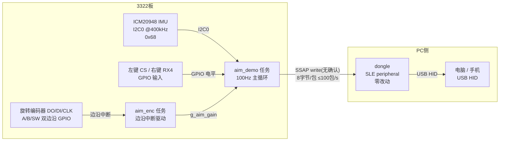
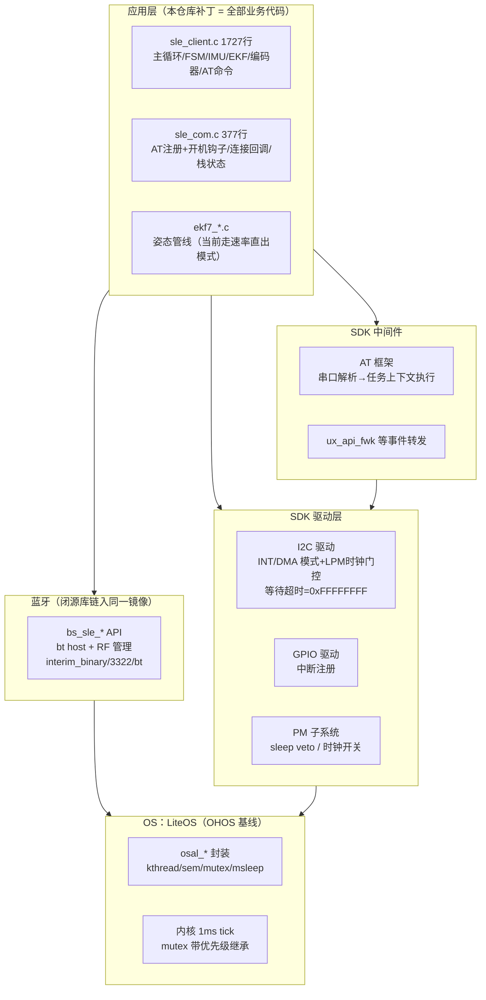
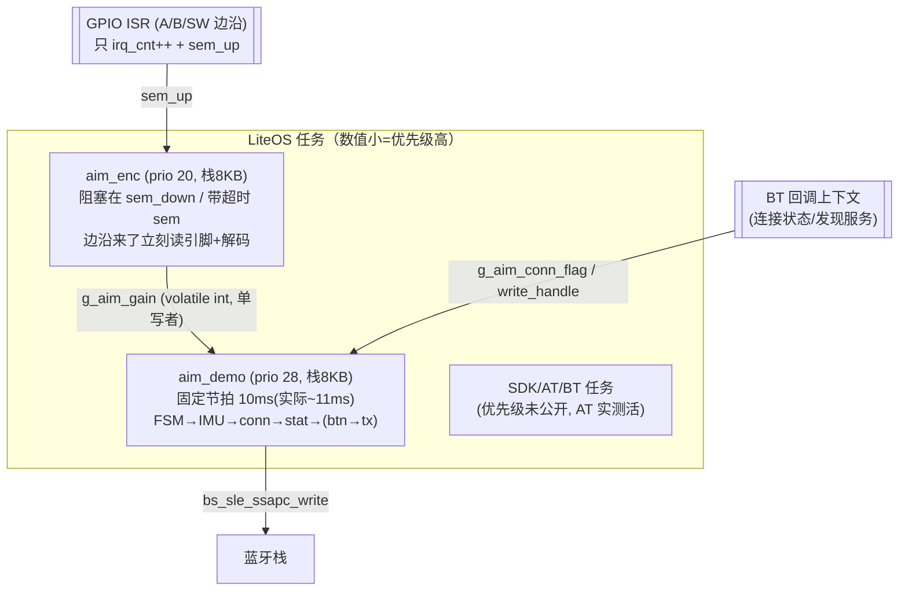
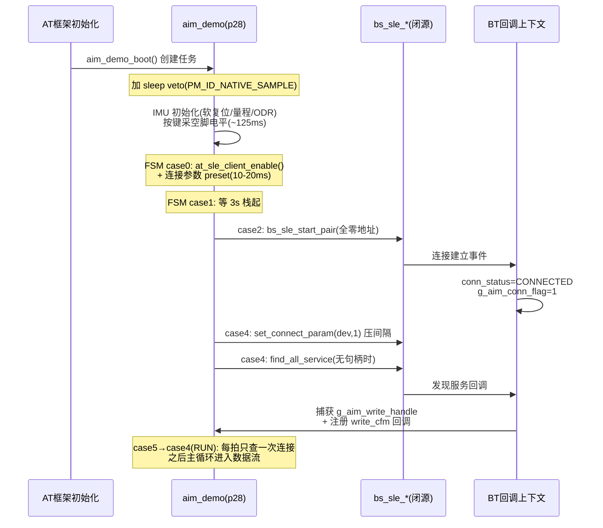
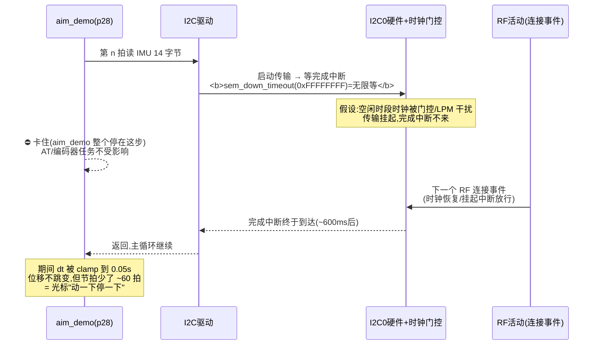

# 3322 空鼠固件 Review 报告（feat/encoder @ acd9375，对应板上 v5）

审查时间：2026-11-24。范围：`patches/hs-fbb/0001-sle-sample-airmouse.patch` 全部内容 + 相关 SDK 驱动/内核源码。
方法：纯静态审查 + 已有上板实测记录（HANDOFF.md、memory），不涉及烧录。

---

## 0. 结论摘要

1. **昨天（acd9375）的改动没有发现错误**。四个修正（陀螺低字节、固定节拍真实积分、亚像素累积、空脚电平判闭合）+ 编码器边沿中断驱动，全部成立，且有 Mac 端仿真背书（motion_sim 17 项、enc_sim 152 项）。
2. **"效果不佳"的直接原因就是那个未解决的空闲卡顿**（连上 dongle 空闲时每约 25 拍卡 ~600ms）。它不在昨天改的代码里，而在 OS/驱动层。
3. **本次审查找到新的首要嫌疑：I2C 驱动的等待超时被配置为无限**（`CONFIG_I2C_WAIT_CONDITION_TIMEOUT = 0xFFFFFFFF`）。I2C 完成中断被拖延多久，主循环就停在驱动里多久——与"只有 aim_demo 被挡、AT 任务 1.4ms 正常、600ms 后自愈"的全部观测吻合。**加强证据：SDK 里其他所有 3322 目标配置此值均为 0x64（100ms），唯独 `diting_community.config` 是 0xFFFFFFFF——目标配置的模板级异常，不是刻意设计。**
4. 同时改判一条旧假设：`bt_sle_is_connected()` **不是闭源库**，是本地 mutex+标志读取（微秒级），从嫌疑名单划掉。
5. 板上 v5 与仓库 acd9375 一致；v6（多 AT+AIM/AT+AIMDBG 调试命令）已编译未烧。定位实验矩阵见 §6，全部只需串口，不需要再烧录。
6. **修复方案 A 已落地到源码级**（2026-11-24 review 会话，未打包、未烧录）：SDK 配置超时改回 100ms（新补丁 0002）+ 应用层防卡死/按键即时性改动（0001 重新导出）。两份仿真全过（motion_sim 17 项、enc_sim 152 项）+ 语法级编译通过 + 补丁双向 apply 校验通过。**注意：`.fbb/firmware/` 里最新的 v6 包不含这些新改动，烧 v6 ≠ 烧新代码；上板前要先出 v7 包。**

---

## 1. 系统架构

### 1.1 角色与硬件框图



- 3322 = SLE **central**，开机自动连 dongle（全零地址直连广播，免扫描）。dongle 侧固件零改动。
- 鼠标协议：自定义 8 字节包（magic 0xA5 + keys + dx + dy），无确认写（write command），背压靠写失败返回值。
- 板与排针之间有 ET5014 电平转换器（J1902 排针域 3.3V），空脚电平被它钉死（MGPIO12~15 读 0、AGPIO12 读 1）——按键/编码器的闭合判断以开机实测空脚电平为基准。

### 1.2 软件分层



- 应用镜像只有 acore 一份；蓝牙 host 以闭源库形式链入同一镜像（`bs_*` API），RF/物理层细节在闭源部分。
- 开机链：`app_run` initcall 在 3322 基线不被驱动 → 实际入口是 **AT 框架初始化** → `at_diting_sle_example_cmd_register`（sle_com.c:14）→ `aim_demo_boot()` → 创建两个任务。

### 1.3 OS 任务图（本固件自建任务）



优先级关系成立：编码器任务(20) 高于主循环(28)，保证边沿→读引脚的延迟最小；两者都不碰彼此的状态量（除 volatile int / 回调置的标志，均无锁竞争）。

---

## 2. 关键时序图

### 2.1 开机 → 自动连接 → 进入数据流



要点：断线回 case2 重配对（15s 超时）；句柄丢失重 FIND（3s 超时再触发）。FSM 是纯每拍推进的状态机，不在 RUN 态时也不阻塞。

### 2.2 主循环单拍（正常路径）

```mermaid
sequenceDiagram
    participant D as aim_demo(p28)
    participant OS as LiteOS(1ms tick)
    participant I2C as I2C驱动(INT模式)
    participant IMU as ICM20948
    participant BT as 蓝牙栈
    D->>OS: next_tick += 10ms; osal_msleep(到点)
    Note over OS: LOS_MS2Tick(10)=10, <b>+1 tick 补偿</b> → 实际周期≈11ms<br>晚醒则重排 next_tick,不连发补拍
    D->>D: fsm(每拍推进,已连接时≈空)
    D->>I2C: 读 0x2D 起 14 字节(400kHz≈0.5ms)
    I2C->>IMU: 传输完成 → ISR → sem_up
    I2C-->>D: 返回 <b>（等不到中断就无限等,见§6）</b>
    D->>D: 解码陀螺(直出模式)→dt积分→亚像素累积
    D->>D: bt_sle_is_connected()=本地mutex读,微秒级
    alt 静止且按键无变化
        D->>D: 不发包,进入下一拍
    else 有位移/按键
        D->>BT: bs_sle_ssapc_write(无确认,8字节)
        BT-->>D: 成功→扣pending / 失败→fail_streak++
    end
```

节拍预算（实测量级）：睡 ~11ms + IMU ~2-3ms + 其余 µs 级 + 每 100 拍统计行 printf ~4ms（300+ 字符 @750k）。名义 100Hz，实际 ~91Hz；**总位移不受影响**——位移按真实 dt 积分，这正是昨天修正的内容。

### 2.3 编码器：边沿 → 灵敏度变化

```mermaid
sequenceDiagram
    participant H as 硬件(A/B/SW 跳变)
    participant ISR as GPIO ISR
    participant E as aim_enc(p20)
    participant D as aim_demo(p28)
    H->>ISR: 任一脚双边沿
    ISR->>E: irq_cnt++; sem_up (中断内只做这两件)
    E->>E: 读 3 个引脚电平
    E->>E: aim_enc_feed: 查表解码(±1/步)<br>满 ±4 步 = 一格 → gain ±2 (10~150)
    E->>D: g_aim_gain 更新(下一拍生效)
    Note over E: 无边沿且无消抖/清零待办时<br>阻塞在 sem_down,零唤醒
```

SW 按下 = 增益复位 42；消抖 20ms 由"候选电平连续时长"实现。定位点停留 100ms 清漏采半格计数。空闲静默——这一点与"1kHz 轮询拖慢主循环"的旧现象（已排除项）自洽。

### 2.4 卡顿嫌疑时序（假设，待板上证实）



与观测对照：只有 aim_demo 被挡 ✓；AT 1.4ms 正常 ✓（AT 不碰 I2C0）；600ms 后自愈 ✓（RF 事件周期性回来）；未连接时不卡 ⚠（待解释，RF 活动形态不同）；"发包时不卡" ⚠（待证实，发包时活动密集时钟不停——机制上自洽但未复核）。

---

## 3. 数据流：陀螺原始读数 → 光标像素

```
I2C 读 14B(raw[6..11]=gx,gy,gz)
→ int16 拼装:高字节 raw[6+i*2],低字节 raw[6+i*2+1]  ←昨天修正点①
→ ±250dps 刻度 /131.072 → °/s → rad/s
→ 减零偏 g_aim_gyro_bias_rad(静止时 EMA α=0.02 跟踪)
→ 轻滤波 k=0.8(τ≈1.25ms@100Hz)
→ 静止门:|ω|<1°/s 持续 0.3s → 不积分(防漂移)
→ 位移 = ω_yaw × gain(px/°) × dt   ←dt=真实经过时间,上限 0.05s ←修正点②
→ 亚像素累积 g_aim_px_acc ←修正点③(零头留到下一拍)
→ 本拍 dx,dy 进 g_aim_pend(±127 clamp,发不出留着下拍发)
→ 8 字节包(0xA5,keys,dx,dy) → SSAP 无确认写
→ 失败连续 8 次 → 退避 20 拍(200ms),位移继续攒
→ 未连接时 pending 清零(防重连跳变)
```

每一步都有仿真对应（motion_sim 17 项覆盖拼装/刻度/dt/累积/静止门）。

---

## 4. 昨天改动（acd9375）逐项判定

| # | 改动 | 判定 | 依据 |
|---|---|---|---|
| 1 | 陀螺低字节 `raw[6+i*2+1]` | ✅ 正确 | 真 bug（初次提交就有），仿真复现+修正后一致 |
| 2 | 固定节拍+真实 dt 积分 | ✅ 正确 | 绝对节拍补偿、晚醒重排不补拍（`sle_client.c:940-948`）；`AIM_DT_MAX_S=0.05` 防跳变 |
| 3 | 亚像素累积+静止门不积分 | ✅ 正确 | 慢速匀速出点；静止 0.3s hold 防误判 |
| 4 | 空脚电平判闭合（键+编码器） | ✅ 正确 | 板上实测三种上下拉读数相同，由板上转换器决定 |
| 5 | 编码器边沿中断驱动 | ✅ 正确 | ISR 只计数+sem_up，OS 用法标准；优先级 20>28 合理 |
| 6 | 默认增益 50→42 | ✅ 合理 | 旧周期 11.8ms 按 10ms 积分的等效换算 |
| 7 | v6 调试命令（AT+AIM/AT+AIMDBG） | ✅ 设计好 | 命令码 0x2AF0/0x2AF1 未占用；读到统计后再烧录-free 定位 |

**结论：昨天的方向和实现都没有问题，不需要回滚任何一项。**

---

## 5. OS/线程模型审查结论（按 fbb 编程模型该有的样子 vs 实际）

| 方面 | fbb/LiteOS 正确姿势 | 本固件现状 | 判定 |
|---|---|---|---|
| 任务划分 | 业务在自建 kthread | aim_demo + aim_enc 两个任务，职责清晰 | ✅ |
| 节拍 | 定时器/信号量驱动或绝对节拍睡眠 | 绝对节拍 `osal_msleep`（1ms tick，+1 tick 补偿→实际 ~11ms/拍） | ✅（dt 积分兜住误差） |
| 中断→任务 | ISR 极短，sem 唤醒任务 | 编码器 ISR 只计数+sem_up | ✅ |
| 任务间数据 | volatile 标志/单写者原子 | gain 单写者 int；conn 标志回调置 | ✅ |
| 阻塞调用 | 驱动等待要有界 | **I2C 等待超时=0xFFFFFFFF（无界）** | ❌ 唯一硬伤 |
| 低功耗 | 业务保活要投 veto | `add_sleep_veto_with_symmetry` 已投 | ✅（但管不到外设时钟门控） |
| 锁 | mutex 短临界区 | 栈状态 mutex 临界区几行赋值 | ✅ |

**单点结论：这套代码在 OS 模型上唯一的真问题，是主循环把"会无限等的驱动调用"放进了 10ms 实时节拍里。** 一切正常时没事；一旦 I2C 完成中断被拖延（无论什么原因），100Hz 实时环就变成"事件驱动"——卡多久完全由硬件/低功耗行为决定。这是结构性风险，值得修（给 IMU 读加有界超时+当拍放弃），与具体根因无关。

---

## 6. 遗留缺陷：空闲卡顿的嫌疑排序

| 排名 | 嫌疑 | 证据 | 反证/未知 |
|---|---|---|---|
| 1 | **I2C 无限等被放大**（中断迟到/时钟门控） | `mconfig.h:42` 超时=0xFFFFFFFF；INT 模式 `i2c.c:344` sem 无限等；porting 层有时钟开关 `i2c_porting.c:218`；"只有 aim_demo 被挡"完美吻合 | 中断为何恰好在"已连接空闲"时迟到 600ms 未证实——需板上 AT+AIM 定位 |
| 2 | `osal_msleep` 睡过头（tickless/PM 路径） | AT+PM=0 无效说明 PM 行为复杂；"发包时不卡"符合同一机制 | v6 的 `sleep overrun` 统计直接量它，一条命令分辨 |
| 3 | 蓝牙栈周期活动抢占（校准/连接事件处理） | 600ms 量级像 RF 节奏；闭源不可读 | 若 aim_demo(28) 被更高优先级抢占，AT 任务也应受影响——实测没有，削弱此嫌疑 |
| ~~4~~ | ~~bt_sle_is_connected 持锁~~ | **已排除**：本地函数，临界区微秒级 | — |
| ~~5~~ | ~~编码器轮询/按键引脚/系统睡眠~~ | **已板上排除**（见 HANDOFF §3） | — |

**分辨实验（烧一次 v6 即可，全部走串口）**：
1. `AT+AIM` → 看 `imu` 行 max_ms 是否 ≈600、`sleep overrun max` 是否 ≈600。二选一直接定案方向。
2. `AT+AIMDBG=0x4`（不读 IMU）→ 卡顿消失 = 嫌疑1 实锤。
3. `AT+AIMDBG=0x10`（空闲强制发包）→ 验证"发包不卡"假设（时钟门控角度）。
4. `AT+AIMDBG=0x2`（连接查询改回调标志）→ 预期无变化（嫌疑4 已静态排除，此步是双保险）。

**修复方案（实锤嫌疑1后按需选用；A 已落地源码级，其余等板上定位后做）**：

- **A.【已落地，见 §8 改动明细】双层防御，与根因解耦**：
  - 配置层（补丁 0002）：`diting_community.config` 的 `CONFIG_I2C_WAIT_CONDITION_TIMEOUT` 0xFFFFFFFF → **0x64（100ms，对齐其他全部 3322 目标）**。超时返回后主循环最多停 100ms（且带错误码），不再无限等。
  - 应用层（补丁 0001）：主循环调用侧给 IMU 读加防御——读失败静默一拍再试（给总线和栈留一拍消化迟到的完成事件）；"成功但耗时 <250µs"当失败丢弃（真实读 14B@400kHz 至少 ~340µs，过快 = 驱动信号量被上一拍迟到的完成事件提前放行、缓冲区是半截数据）。丢一拍采样无感，静止门兜住漂移。
  - 防御逻辑放在主循环调用侧而非 `aim_ekf_step` 内部：后者是 motion_sim 的抽取片，保持纯管线语义，仿真零改动全过。
- B.【待板上实锤后】时钟状态配置：3322 的 PM 时钟 API 是 `uapi_clocks_config_mode(pm_veto_id_t uid, pm_mode_t mode)`（`pm_clocks.h`）和 `uapi_clocks_switch(id, on/off)`（`CLOCKS_ID_M_I2C0`）。注意：I2C 驱动的 `i2c_port_clock_dynamic_enable` LPM 钩子在 3322 上是 **weak 空实现**（porting 层没覆写），驱动层自己不做动态时钟开关——时钟门控如果存在，来自 PM 子系统层面，用上面的 API 查。
- C.【备选】I2C 改轮询模式：关掉 `CONFIG_I2C_SUPPORT_INT/DMA` 走 POLL busy-wait 路径（`i2c.c:284` 起即 POLL 型），不依赖完成中断，但占用 CPU ~0.5ms/拍，且同样受 `CONFIG_I2C_WAIT_CONDITION_TIMEOUT` 约束。仅当"中断完成路径本身有毛病"时才值得。
- D.【如根因是连接参数】检查 dongle 侧协商出的实际连接间隔（固件只投了 10-20ms 的 preset，`set_connect_param(dev,1)` 是否真被接受未知）——如果空口节奏是亚秒级事件，"600ms 卡顿与 RF 事件对齐"的假设就成立，治本在连接参数。

---

## 7. 其他发现（非卡顿，按优先级）

- **P2 退避期间按键不扫**——**已修**（补丁 0001）：按键每拍都扫（退避中也扫），按键沿不等退避直接发（写失败自然续期退避）；`s_prev_keys_sent` 改为发出成功才更新，写失败时按键沿下一拍还能重试，快速点按在瞬时写失败下不再丢。位移 clamp 到 ±127 的有损语义保留（快甩+队列满时超出部分丢，防跳变优先）。
- **P3 流控纯靠失败计数**：无确认写 + 连续 8 败退避，是唯一背压手段；write_cfm 回调已注册但未用于流控。够用，但若 dongle 侧缓冲特性变化需重调 8/20 两个常数。
- **P3 统计行 printf 同步打**：每 100 拍 ~4ms，占节拍预算 ~4%，可接受；调试结束后建议精简。
- **P4 AT+AIM 与主循环对统计结构非原子读写**：调试用，可接受，知道即可。
- **P4 `process_sle_disable_result` 销毁 mutex**：若有任务正阻塞在该 mutex 上时销毁是未定义行为——仅在栈禁用路径，当前固件不会走到，留意即可。
- **P3 double 软浮点预算**：100Hz 余量够，200Hz 已实测打死（注释留档）。不要轻率提频。
- **P4 FSM FIND 重试**：句柄未捕获时每 3s 重发 find_all_service，回调打印很长——连接初期日志多属正常。

---

## 8. 本次已落地的改动明细（源码级，未打包未烧录）

| 文件 | 改动 | 验证 |
|---|---|---|
| `patches/hs-fbb/0001-sle-sample-airmouse.patch`（重新导出） | ① 主循环 IMU 读防御：失败静默一拍 + "过快成功"判废（§6 方案 A 应用层）；② 按键/退避重构（§7 P2） | motion_sim 17 项 ✓ enc_sim 152 项 ✓ 语法编译 ✓ |
| `patches/hs-fbb/0002-i2c-bounded-wait-timeout.patch`（新增） | `diting_community.config`：I2C 等待超时 0xFFFFFFFF → 0x64（对齐其他 3322 目标） | 构建后 mconfig.h 实证为 0x64 ✓ |
| `apply.sh` | 增加 0002 的 check+apply | 补丁双向 apply 校验 ✓ |
| `tools/motion_sim/motion_sim.c` | 无净改动（防御逻辑刻意放抽取片之外，管线语义不变） | 17 项全过 ✓ |

## 9. 剩下的事（按顺序）

1. 【板上，用户回家后】**先按 HANDOFF §1 恢复原厂 flash 备份**（用户的既定第一任务），或者用户改主意直接烧 v7。
2. 【打包】用当前源码出 v7 包（`python3 build.py diting-community -release`，6~10 分钟）——**v6 包不含本 review 的任何改动**。
3. 【定位】按 §6 分辨实验矩阵走串口：`AT+AIM` → `AT+AIMDBG=0x4` → `AT+AIMDBG=0x10`。若 0x4 消卡顿且实锤 I2C，观察新固件上卡顿是否已从 600ms 变 ≤100ms（0002 的直接效果）。
4. 【按定位结果】选 §6 B/C/D 之一治本；同时把 v7 之前的行为差异（若卡顿形态变化）记录回 HANDOFF。
5. 【提交】所有改动目前未提交（用户习惯：不主动 commit）；要不要把 review+修复合成一个提交、还是拆开，由用户定。

---

*报告基于静态审查；所有"板上"结论引自 HANDOFF/memory 的既有实测记录。§8 改动已通过仿真与语法级编译，打包烧录等板子到手后按 §9 顺序执行。*
